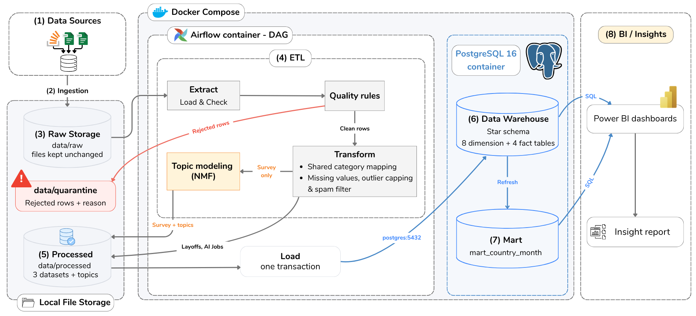
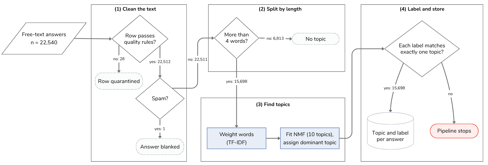
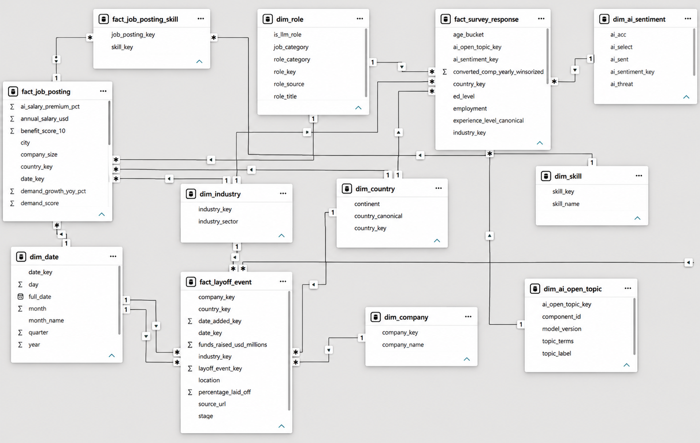
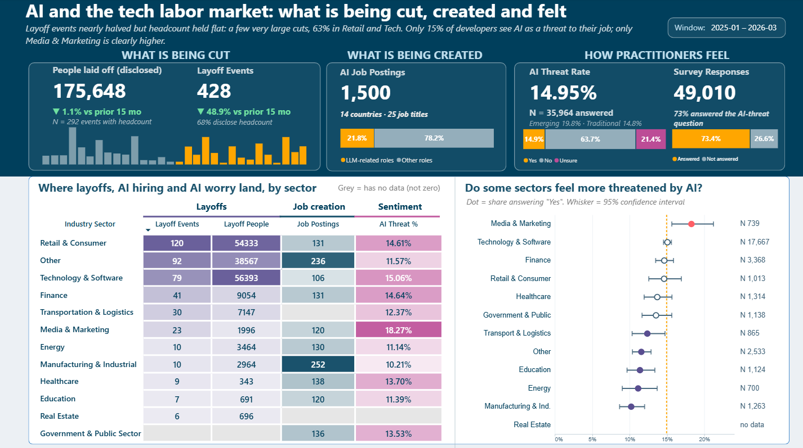
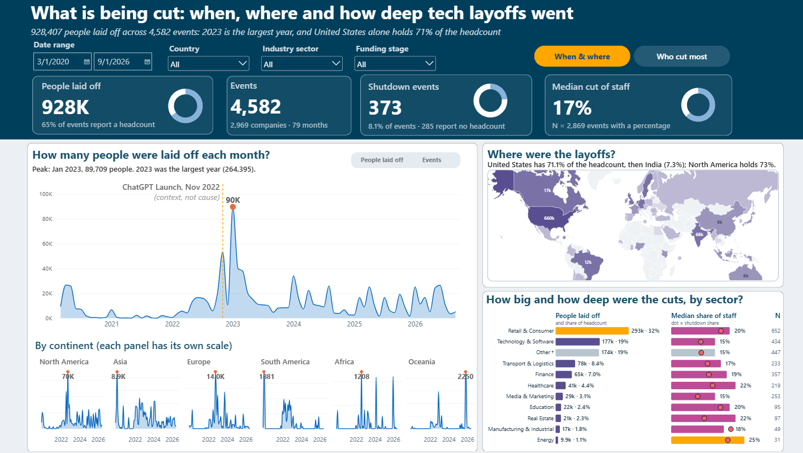
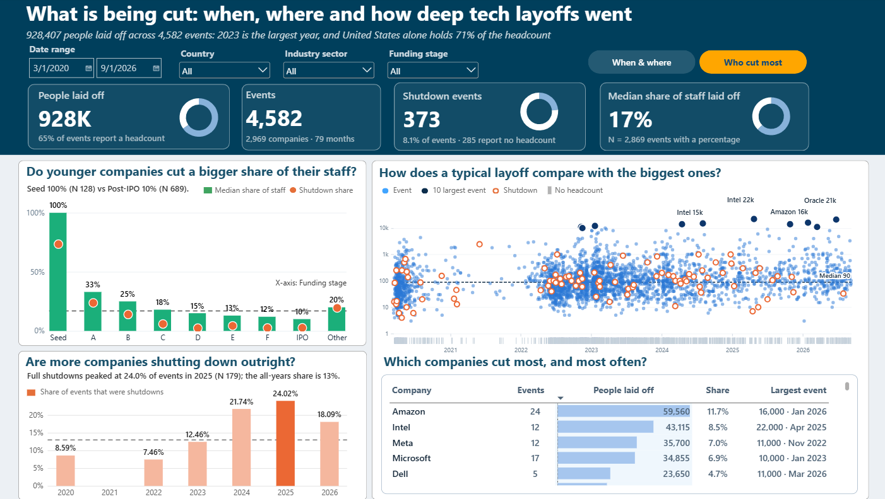
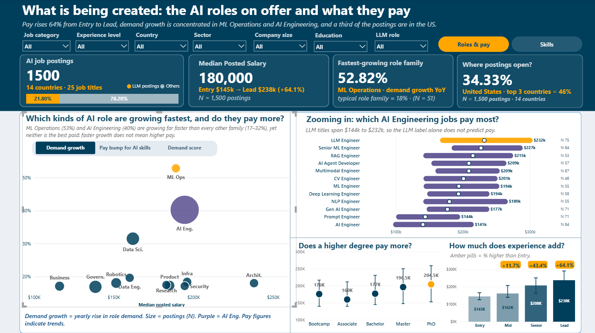
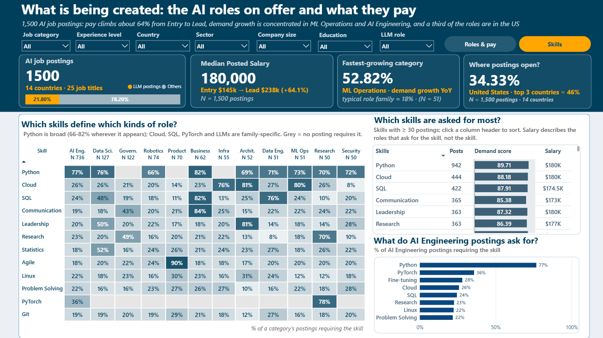
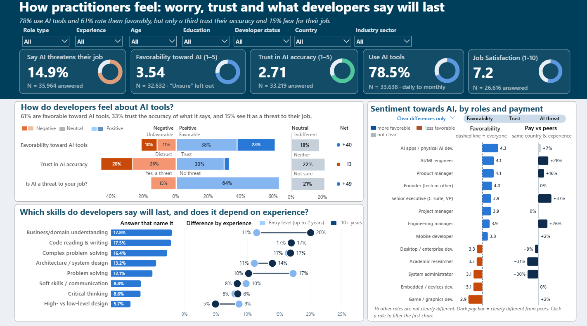
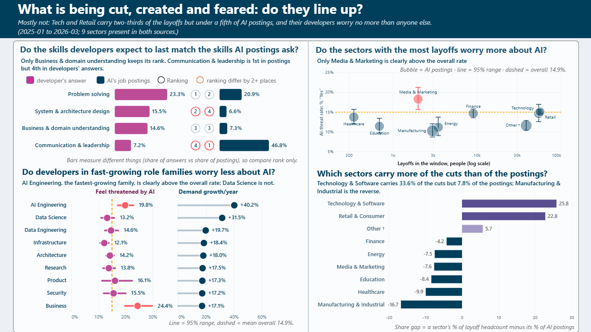

# AI Job Market Disruption

Since 2020 the technology industry has gone through repeated waves of layoffs, and over the same period generative AI tools have spread through software work. Against this backdrop, a handful of questions are worth asking together:

- Who is being laid off, how many people, and when?
- What is being created in their place: which AI roles, and at what pay?
- How do the people still working in the field feel about it?
- Which of their skills do they expect to stay valuable?

Public data can answer each question, but only separately: layoff trackers cover the first, job postings the second, and developer surveys the last two. Read in isolation, no single source can say whether the pieces fit together, for example whether the sectors that cut the most are also the ones hiring AI talent or worrying the most. This project therefore aims for one comprehensive picture. It combines three public datasets, about 55,000 records in total, in a single PostgreSQL warehouse and presents them side by side in a five-dashboard Power BI report.

**Authors:** [Viet Khoa Nguyen](https://github.com/nguyenvietkhoa1409) and [Mai Anh Tieu](https://github.com/maianhtieu87)

## Overview

The project has seven components, each described in its own section below:

- **A reproducible ETL pipeline.** A Python batch pipeline extracts, cleans and transforms the three datasets, and Airflow runs the whole sequence in Docker in about *28 seconds*.
- **Data quality without silent deletion.** Every record is checked against explicit rules, and a record that fails goes to a quarantine file together with the reason.
- **Conformed dimensions.** Country, industry, role, experience level and skill are mapped once to shared lists, so the three sources use the same vocabulary.
- **A PostgreSQL star schema.** Three fact tables share the conformed dimensions, and a materialized mart precomputes the country-by-month totals.
- **A stable topic model.** NMF sorts the survey's free-text answers into ten themes, and anchor-word labels keep those themes consistent across refreshes.
- **Automated testing with continuous integration.** Unit tests, database tests and a DAG integrity check run on GitHub Actions.
- **Interactive dashboards and an insight report.** A Power BI report of five dashboards answers one question per page.

> **Read the results as patterns, not causes.** The sources can only be linked through shared categories such as sector and role family, and 35% of layoff events report no headcount.

## Repository structure

The folders follow the components above: `data_sources`, `quality`, `preprocessing` and `schema` implement the ETL, data quality and conformed dimensions, `feature_engineering` holds the topic model, `warehouse` and the SQL in `schema/` build the star schema, `airflow/` orchestrates the run, and `tests/` with the CI workflow covers testing.

```
src/
├── data_sources/         # BaseDataSource + per-dataset loaders
├── quality/              # BaseQualityRuleSet + per-dataset quality rules
├── preprocessing/        # BaseTransformer + per-dataset cleaning transforms
├── feature_engineering/  # BaseFeatureEngineer + SurveyFeatureEngineer (NMF topics)
├── eda/                  # DatasetProfiler, EDAVisualizer
├── schema/               # dimension maps + star schema dataclasses
├── warehouse/loader.py   # WarehouseLoader: processed CSVs -> Postgres star schema
├── pipeline.py           # DatasetPipeline: chains the interfaces above
└── config.py             # ProjectPaths

schema/                   # SQL run by Postgres: dimensions, facts, country-month mart
airflow/dags/             # warehouse_pipeline_dag.py
data/{raw,processed,quarantine}/   # not committed, see .gitignore
reports/                  # data dictionary, EDA notes, figures used in this README
tests/

run_pipeline.py           # extract/clean/transform all 3 datasets (no database)
setup_database.py         # apply schema/*.sql; --reset rebuilds from scratch
validate_sources.py       # smoke test that the raw files load
docker-compose.yml        # postgres (5432) + airflow standalone (8080)
```

The SQL in `schema/` is what Postgres executes, and `src/schema/` is its Python mirror, which `tests/test_star_schema.py` keeps in sync. The project scope and the team's Git workflow guide are in `Layoff Project.md`.

## Data sources

| Dataset | One row is | Raw rows | Period covered | Notable gaps |
| :---- | :---- | ----: | :---- | :---- |
| Layoffs (Layoffs.fyi tracker) | A layoff event | 4,600 | 2020-03-11 to 2026-09-08 | No role or experience fields |
| AI Jobs Market 2025-2026 Salaries | A job posting | 1,500 | 2025-01 to 2026-03 | Month only; 25 roles, 14 countries |
| Stack Overflow Developer Survey 2025 | A survey respondent | 49,191 | Single wave (2025) | No respondent-level date |

The three datasets are deliberately different in grain and in what they can say, so each one stands for one side of the story. The Layoffs and Stack Overflow datasets are released under the Open Data Commons Open Database License (ODbL), and the AI Jobs dataset is used under its public open-data terms. The raw files are not stored in this repository; [Data](#data) explains where to place them, and `Layoff Project.md` holds the full field-by-field dictionary.

### Layoffs: the loss side

The [Layoffs dataset](https://www.kaggle.com/datasets/swaptr/layoffs-2022) comes from Layoffs.fyi, a technology-sector layoff tracker founded by Roger Lee in 2020 and mirrored on Kaggle. The version used here holds **4,600 records** up to September 2026. It is event-level: each row is one reported layoff, so a company appears more than once if it reported layoffs on separate occasions. The 11 fields describe the company, the scale of the layoff, the industry, the funding stage and the location. Three details shape how it is handled. People laid off (`total_laid_off`) is empty whenever only a percentage was disclosed, which is why headcount totals are lower bounds. The percentage (`percentage_laid_off`) is stored on a 0 to 1 scale and not 0 to 100. And `date_added`, the day the tracker recorded the event, is distinct from the day of the layoff itself.

### AI Jobs: the creation side

The [AI Jobs Market 2025-2026 Salaries dataset](https://www.kaggle.com/datasets/alitaqishah/ai-jobs-market-2025-2026-salaries) contains **1,500 job postings** for 25 distinct roles in 14 countries, one row per posting. Its 25 fields cover the role (title and one of 12 job categories), the required experience level and education, the posted salary and its range in USD, the location and company, the work arrangement, and a pipe-delimited list of required skills. Three further fields, an AI salary premium, a demand score and a year-over-year demand growth, are supplied with the dataset and not measured from the 15-month series, so the dashboards read them as directions. In this project the dataset shows which AI-related roles are emerging and how they are paid.

### Stack Overflow Developer Survey: the sentiment side

The [2025 Stack Overflow Developer Survey](https://survey.stackoverflow.co/) is the public release of the annual developer survey, taken from a [Kaggle CSV copy](https://www.kaggle.com/datasets/edoardogalli/stack-overflow-annual-developer-survey-2025). It contains **49,191 valid responses** across 172 columns, of which the pipeline reads only the **18** that serve this project: demographics, employment, compensation, job satisfaction and four attitudes toward AI (threat, usage, sentiment and trust in accuracy). Many optional fields are empty for roughly 27% to 51% of respondents. These gaps are kept as an explicit "Not answered" category and never imputed. The eighteenth field, `AIOpen`, is an optional free-text answer in which respondents describe the skills they believe will remain valuable despite AI. It is empty for about 54% of respondents and is the only free-text field in scope, reserved for the topic model.

## Architecture

The system operates as an **eight-layer** batch data pipeline (Figure 1). Three public CSV datasets **(1)** are manually ingested **(2)** and stored as immutable files in **raw storage (3)**. In the **ETL layer (4)**, each dataset runs through a dedicated pipeline that validates the schema, quarantines anomalous records, maps shared dimensions, handles missing values, caps outliers and filters spam. The survey pipeline also incorporates **NMF topic modeling**, passing 10 topics across 15,698 responses as standard categorical data into the warehouse.

Next, the **processed files (5)** are loaded into a **PostgreSQL star schema** through a single atomic transaction **(6)**, so a load either completes or leaves the database untouched. A **data mart (7)** then computes materialized views for the map visualizations. In the **presentation layer (8)**, Power BI queries the warehouse and the mart with SQL to drive the dashboards and the insight report. **Apache Airflow** orchestrates layers **(4) through (7)** inside **Docker Compose**, which also hosts PostgreSQL.



*Figure 1. End-to-end architecture from the public sources to the BI layer. Rejected rows go to a quarantine area, and topic modeling applies to the survey only.*

| Layer | Technology | Why |
| :---- | :---- | :---- |
| Processing | Python (pandas) | 55,291 raw rows fit in single-node memory, so a distributed engine such as Spark is unnecessary. |
| Warehouse | PostgreSQL | Enforces keys and constraints and supports materialized views; a cloud warehouse is not warranted at this scale. |
| Orchestration | Apache Airflow, Docker Compose | Task dependencies, retries and per-task logs that cron lacks, in a reproducible environment. |
| BI | Power BI Desktop | Relational modeling and DAX time-intelligence measures over a continuous calendar table. |

## Data engineering

### Pipeline and data quality

All three datasets pass through the same ETL template, which covers schema validation, quality checks, transformation and profiling; only the settings differ. The pipelines read 11, 25 and 18 columns and apply 7, 9 and 8 quality rules respectively. Extraction stops immediately if an expected column is missing, so a change in a file's format cannot corrupt the warehouse unnoticed, and outputs are overwritten on every run, which makes re-running always safe. Rows that fail a rule are never deleted quietly. Of the 24 rules, only three have flagged any rows so far, and the other 21 exist to protect future refreshes. The table below shows that every raw row is accounted for.

| Dataset | Raw rows | Quarantined | Loaded rows | Unaccounted |
| :---- | ----: | ----: | ----: | ----: |
| Layoffs | 4,600 | 18 (0.39%) | 4,582 | 0 |
| AI Jobs | 1,500 | 0 (0%) | 1,500 | 0 |
| Survey | 49,191 | 113 (0.23%) | 49,078 | 0 |
| **Total** | **55,291** | **131 (0.24%)** | **55,160** | **0** |

We tested each rule on the real data before adopting it, which is why only three of them fire today:

- **Duplicate layoffs.** 17 groups of duplicated events (35 rows in all) were reduced to one row each by keeping the latest timestamp, which quarantined the 18 older rows.
- **Impossible experience.** 113 survey respondents were quarantined because their years of work were impossible for their age.
- **Two rules we rejected.** Capping experience by years of coding would have dropped *8.9%* of valid survey rows, and a hard salary ceiling would have rejected *19.2%* of AI Jobs postings because of ordinary noise. Both would have thrown away good data.

### Conformed dimensions

The three sources describe the same world in different words, so country, industry, role, experience level and skill are each mapped once to a standard list. A label with no match is quarantined and never dumped into a catch-all category, although no row has needed that so far. Missing values are left missing and not guessed. Survey respondents who skipped the AI questions (27% to 32%) are labeled "Not answered" and left out of rate denominators, and layoff events without a headcount keep a SQL NULL, which makes every headcount total a lower bound.

| Category | Raw to standard | Notes |
| :---- | :---- | :---- |
| Country | 188 labels to 175 countries | ISO 3166-based conversion resolves 185 labels; 3 manual rules remain. |
| Industry | 46 labels to 12 sectors | Curated mapping inspired by NAICS, with an "Other" group. |
| Role | 25 job titles and 32 developer types to 2 groups | All AI Jobs titles are Emerging, so role salaries are not comparable across sources. |
| Experience level | Text labels and work years to 4 levels | Entry (0-2 years), Mid (3-5), Senior (6-9), Lead (10 or more). |
| Skill | 93 raw skills to 91 skills | Two merges, such as "LLM Fine-tuning" to "Fine-tuning". |

### Warehouse

Layoffs, job postings and survey responses are recorded at different levels of detail, so the warehouse keeps one fact table for each and lets all three share the same dimension tables, a design known as a fact constellation. Four modeling choices are worth noting:

- **Composite key for layoffs.** An event is identified by company, date and location together, because without the location five distinct events would collide.
- **One table for survey answers.** The 49,078 responses use only 641 distinct combinations of AI answers, which are stored once in a single table (a *junk dimension*).
- **Bridge table for skills.** Each posting's skill list is split into 9,419 posting-skill pairs, so skills can be joined efficiently.
- **Precomputed mart.** A 789-row materialized view holds layoffs by country and month and adds up to exactly the 4,582 base events.



*Figure 2. Entity-relationship diagram: 8 dimension tables, 4 fact tables and 1 summary view.*

The loader writes all tables in one transaction and skips rows that already exist, so loading the same files twice inserts nothing, which the automated tests verify. We checked the load in four ways:

- the fact tables match the clean row counts above;
- the database raised no key or constraint violation;
- a repeat load added no rows;
- the mart reconciles to the base events.

## Topic modeling of open answers

One survey question asks which skills developers expect AI not to replace. Of the 49,191 respondents, 22,540 wrote an answer and 22,511 passed the quality and spam checks. Answers of four words or fewer (30.3%) say too little to classify, which leaves 15,698 answers for the model. Each answer is converted into TF-IDF vectors, which weight words by how distinctive they are, and non-negative matrix factorization (NMF) then factors them into ten topics. Every answer is assigned to the topic where it scores highest.



*Figure 3. From raw text to dimensional topic assignments. Dashed borders mark filtered records; the red node is the automatic halt on a label mismatch.*

We chose NMF over BERTopic after one exploratory run on 8,000 answers. BERTopic returned only two broad clusters, whereas NMF produced ten topics that were easy to name from their top terms. A likely reason is that all respondents answered the same question, so their answers mean similar things and differ mainly in wording, which suits a word-based method. A single sample run is not a definitive benchmark, however.

**Keeping labels stable.** NMF has a practical weakness: the numbering of its topics is arbitrary and changes between runs. In ten test runs with 5% to 10% of rows removed, the order shifted and topics merged or appeared seven times, so labeling topics by index would silently mislabel thousands of answers on a refresh. Each label is therefore tied to *anchor words* and is given to a topic only if the topic's top ten terms contain all of them. When a label matches no topic or several, the pipeline stops and logs the new top terms, and a reviewer then updates the anchors and increments the model version. This guards against structural drift, but it does not measure how coherent the topics are.

| Topic label | Anchor words | Answers | Share |
| :---- | :---- | ----: | ----: |
| Business/domain understanding | "understanding business" | 2,301 | 14.7% |
| Code reading & writing | "code", "writing" | 2,237 | 14.3% |
| AI capability skepticism | "ai tools" | 2,098 | 13.4% |
| Complex-problem-solving ability | "complex problems" | 2,097 | 13.4% |
| Software architecture / system design | "software architecture" | 1,705 | 10.9% |
| Problem solving | "problem solving" | 1,557 | 9.9% |
| Soft skills / communication | "soft skills" | 1,135 | 7.2% |
| Critical thinking | "critical thinking" | 1,112 | 7.1% |
| High-level vs. low-level design | "high level", "low level" | 733 | 4.7% |
| Skills will remain valuable (generic) | "remain valuable" | 723 | 4.6% |

Shares refer to the 15,698 modeled answers and are rounded, so they sum to 100.2%.

## Analytics and findings

The Power BI report is organized so that each dashboard answers a single question, and each page states its finding in the subtitle.

| Dashboard | Question | Basis |
| :---- | :---- | :---- |
| Overview | What is being cut, created and felt, and where do the three meet? | 2025-01 to 2026-03 window |
| Layoffs (2 pages) | When, where and how deeply were jobs cut, and who cut most? | Full history, 2020-03 to 2026-09 |
| Role & Creation (2 pages) | Which AI roles are on offer, what do they pay, and what do they ask for? | 1,500 postings |
| Sentiment | How do practitioners feel about AI, and which skills do they expect to last? | 2025 survey, single wave |
| Cross-source | Do cuts, postings and worry point the same way? | Window; sectors present in both sources |

Three conventions keep the numbers honest:

- **Aligned window.** The Overview and Cross-source pages compare the 15 months covered by the postings with the 15 months before them. The survey has no respondent-level date, so it is read as a single snapshot.
- **Missing values are shown, not filled.** Headcount tiles state how many events report one, and every survey rate shows its sample size.
- **Uncertainty drives the wording.** A difference between groups is called *clear* only when its 95% interval excludes the overall rate.

### Findings at a glance

| Question | Finding |
| :---- | :---- |
| How large and how timed are the layoffs? | From 2025-01 to 2026-03, events fell 48.9% against the previous 15 months while headcount fell only 1.1%. Ten events hold 54.1% of the window's headcount, so cuts became fewer but larger. |
| Which AI roles are created, and at what pay? | Median posted salary rises 64% from Entry ($145k) to Lead ($238k). Demand growth is concentrated in ML Operations (+53% a year) and AI Engineering (+40%). |
| How do developers feel about AI? | 78.5% use it at least monthly, 46% distrust its accuracy, and 14.9% see it as a threat to their job. Business understanding, code reading and complex problem-solving are the skills they expect to last. |
| Do the three sources line up? | Mostly no. Technology & Software holds 33.6% of the cuts but 7.8% of the AI postings, and only Media & Marketing shows clearly above-average worry. |

The sections that follow take each question in turn.



*Figure 4. Overview dashboard: workforce reductions, emerging roles and practitioner sentiment, with a sector grid and a dot plot of AI-threat rates.*

### Layoffs: fewer, larger cuts

*Core question: how large, how timed and how deep are the layoffs?*

- **Fewer events, similar headcount.** In the window, events fell **48.9%** against the previous 15 months (428 events), yet people laid off fell only **1.1%** (175,648). The ten largest events account for **54.1%** of the headcount, so layoffs have become less frequent but more concentrated.
- **The long view.** Since March 2020 the tracker records 928,407 people across 4,582 events and 2,969 companies. Layoffs peaked in January 2023 (89,709 people), and the United States accounts for 71.1% of the total.
- **Sector size is not sector depth.** Retail & Consumer lost the most people (293,000, or 32%), followed by Technology & Software (177,000, or 19%), but most sectors cut a median of 15% to 22% of their staff.
- **Young companies close, they do not just shrink.** The median Seed-stage layoff removes **100%** of staff, against 10% after an IPO, largely because about three in four Seed events are shutdowns.



*Figure 5. Layoffs dashboard (when and where): monthly trend by continent, geographic distribution and sector severity.*



*Figure 6. Layoffs dashboard (who cut most): median reduction by funding stage, shutdown share by year and the weight of the ten largest events.*

### AI roles and salaries: what is being created

*Core question: which AI roles are being created, and what do they pay?*

- **Seniority is the biggest pay lever.** Median posted salary climbs from $145,000 at Entry to $238,000 at Lead (**+64%**). Title matters even within one family: in AI Engineering, medians range from $141,000 for an AI Engineer to $232,000 for an LLM Engineer, so the "AI" label alone says little. Education matters less, since a PhD earns about 16% more than a Bachelor's with heavily overlapping ranges.
- **Growth and pay do not travel together.** ML Operations (+53% a year) and AI Engineering (+40%) are growing fastest, against about 18% for a typical family, while Architecture pays the most of the 12 families but grows only about 18%.
- **Skills are role-specific, around a common core.** Python is the most requested skill (942 postings), yet three families list none, and Cloud and PyTorch belong to particular families.

*Caution:* outside AI Engineering each family has only 50 to 127 postings, and its growth and demand figures come with the dataset, so we read them as directions and not as precise measurements.



*Figure 7. Role and Creation dashboard (roles and pay): role families by median salary against demand, and pay by title, education and experience.*



*Figure 8. Role and Creation dashboard (skills): which skills define which role families.*

### Practitioner sentiment

*Core question: how do developers feel about AI, and what do they expect to last?*

- **Use outruns trust.** **78.5%** use AI at least monthly, yet **46%** distrust its accuracy and **14.9%** see it as a threat to their job.
- **Worry varies by role and sector.** It is highest among UX, research and UI designers (29%) and data or business analysts (24%). Media & Marketing (18.3%, N=739) is the only sector clearly above the average.
- **Skills expected to last.** Respondents most often name business and domain understanding (17.8%), code reading and writing (17.5%) and complex problem-solving (16.4%). Experience shifts the answer: developers with ten or more years name business understanding more often than entry-level ones (20% vs 11%), while entry-level developers lean toward problem solving (17% vs 10%).

*Caution:* respondents chose to take the survey, so the reported intervals understate the true uncertainty.



*Figure 9. Sentiment dashboard: favorability, trust, perceived automation threat and the skills expected to remain valuable.*

### Cross-source reading

*Core question: do the sectors with the deepest cuts also show the most AI hiring and the most worry?*

The three sources share only sector and role-family categories, so this page checks whether they line up at that coarse level and cannot test cause and effect. Across the nine sectors present in both sources, **mostly they do not**:

- **Cuts and AI hiring diverge.** Technology & Software accounts for 33.6% of the cuts but only 7.8% of the postings, and Technology and Retail together carry 66% of the headcount against 17% of the postings.
- **Cuts and worry diverge.** The two biggest cutters sit at the average level of worry, and the rank correlation between layoffs and threat is about 0.28, which is not significant.
- **Growth and worry diverge.** The fastest-growing matched role family, AI Engineering, reports 19.8% threat against 14.9% overall.
- **Skills only partly agree.** Of four matched skills, only business and domain understanding keeps its rank.

The data therefore support a narrower claim than a single story: *no one sector pattern fits cuts, hiring and worry at the same time.*



*Figure 10. Cross-source dashboard: sector-level cuts against AI postings, and role-family demand growth against practitioner threat perception.*

## Limitations

- **Static ingestion.** The sources are snapshots loaded by hand, with no streaming.
- **Missing headcount.** 34.8% of layoff events report none, so totals are conservative lower bounds.
- **No causal links.** The sources are joined by shared categories and not by company or person. Layoff events are company decisions, survey answers are individual opinions, and the postings cover AI roles only, so the results cannot show cause and effect. Settling that question would require company-level links, dated survey waves and layoffs tagged with their reason.

## Getting started

The project needs **Python 3.12** (the pinned `numpy==2.5.3` has no wheels for 3.11 or earlier) and Docker.

```
python -m venv .venv
.venv\Scripts\activate
pip install -r requirements.txt
pytest -q
```

### Data

Raw datasets are not committed. Place the source files under `data/raw/` and smoke test that they load:

```
data/raw/layoffs.csv
data/raw/ai_jobs_market_2025_2026.csv
data/raw/survey_results_public.csv
python validate_sources.py
```

### Run the pipeline

Start PostgreSQL, then clean the data, create the schema and load the warehouse:

```
cp .env.example .env
docker compose up -d postgres
python run_pipeline.py              # extract, clean, transform -> data/processed/
python setup_database.py            # idempotent; --reset drops and rebuilds all tables
python -m src.warehouse.loader      # dims -> facts -> bridge -> refresh the mart
```

The loader runs as one transaction and prints the rows inserted per table. With the current raw files it inserts 4,582 layoff events, 1,500 job postings, 49,078 survey responses and 9,419 posting-skill pairs, and `mart_country_month` sums to 4,582 events. `.env` holds local credentials and is gitignored.

### Run with Airflow

`docker compose up -d` also starts Airflow at http://localhost:8080. The DAG `ai_job_disruption_warehouse` runs the three extract-transform tasks and the schema gate, then loads the warehouse in a single transactional task. It is triggered manually and never resets the schema.

```
docker compose build airflow
docker compose up -d
docker exec ai_job_disruption_airflow cat /opt/airflow/standalone_admin_password.txt
docker exec ai_job_disruption_airflow airflow dags trigger ai_job_disruption_warehouse
```

### Tests

`pytest -q` runs the unit tests. The loader integration tests run only when a Postgres from `.env` is reachable, and they drop and recreate the `public` schema, so never point `.env` at a database whose data matters. The DAG integrity test needs Airflow and runs in the CI `dag-integrity` job (`.github/workflows/tests.yml`), alongside the `pytest` job that uses a `postgres:16` service.

## Contributing

`main` is protected. Work happens on `feature/*`, `fix/*` or `docs/*` branches merged through pull requests; the branching model and conflict-handling procedures are in the Git guide inside `Layoff Project.md`.
